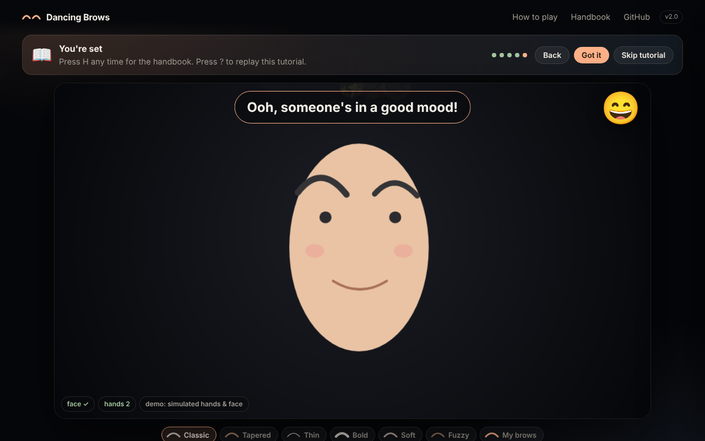
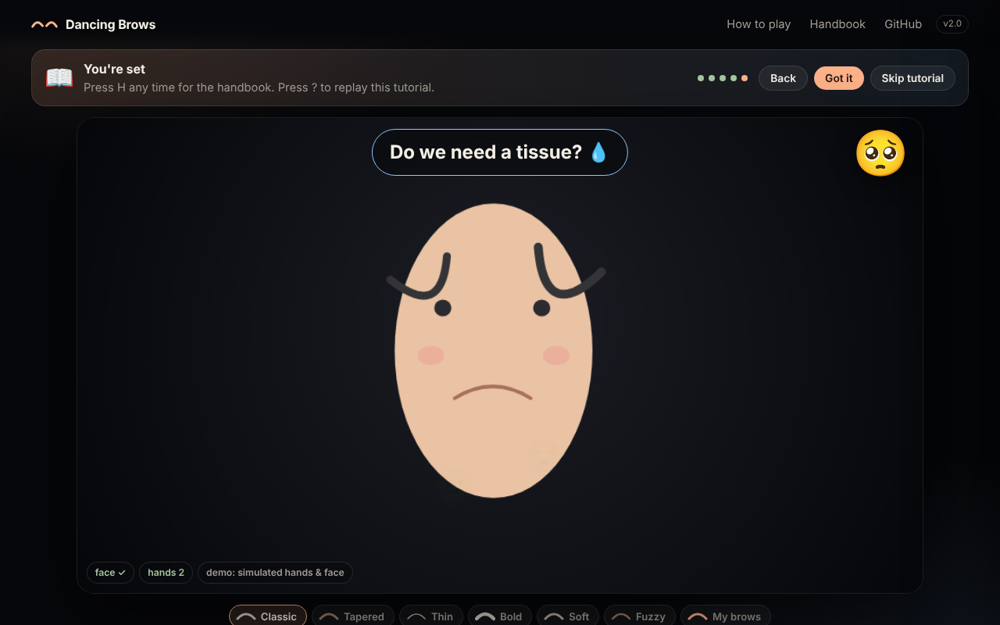
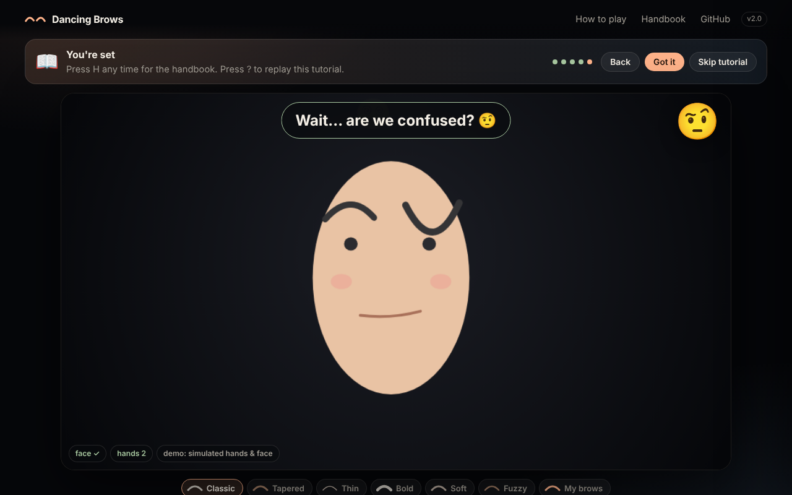

# Brow Instrument

  <!-- TODO: record a ~10 s clip and save as assets/demo.gif -->

Your hands puppeteer a cartoon eyebrow on a live webcam feed, and the brow's height plays a note. A small theremin you conduct with your face and fingers.

## Web version (new)

`web/` is a browser version you can open from the homepage, no install. It adds a skippable tutorial, an in-page handbook, a dark gesture.live-style stage, and **mood effects**: two open, arched brows read as *happy* (giggle + bouncing emoji), two pinched or drooping brows as *sad* (tears + a sad "womp womp"), and brows that disagree as *confused* (boing + floating question marks), each with a cue like "Are we sad now?".

```bash
cd web
python3 -m http.server 8000      # then open http://localhost:8000  (camera needs localhost or https)
npm test                         # 33 unit tests on the brow maths, hand identity, moods and tutorial logic
```

- **Try the demo** needs no camera: scripted hands and a drawn face run the same brow, mood and sound code.
- **Start camera** uses MediaPipe FaceLandmarker + HandLandmarker in the browser. Models and scripts load from public CDNs; video never leaves your machine.
- Deploy: the workflow in `.github/workflows/pages.yml` publishes `web/` to GitHub Pages (Settings > Pages > Source: GitHub Actions).
- How the mood is decided: `web/js/expression.js`. The thresholds were chosen by feel, not measured on users. Sounds are synthesised with the Web Audio API (`web/js/audio.js`).
- Screenshots below are from **demo mode** (simulated hands and a drawn face), not a real camera session.
- TODO: record a real-camera demo GIF of the three moods and put the live link here.

| Happy | Sad | Confused |
|---|---|---|
|  |  |  |

The Python/OpenCV app below is the original desktop prototype and the part that is benchmarked.

## The question

Can a webcam and two hands drive an expressive cartoon brow (height, curve, tilt, spacing) and a sound in real time, fast enough to feel instant?

## Run it

```bash
python -m venv .venv && source .venv/bin/activate   # Windows: .venv\Scripts\activate
pip install -r requirements.txt
python main.py            # add --erase to hide your real brows, --no-audio for silent
```

Keys: `s` next brow style, `b` capture my own brows, `e` erase real brows, `m` mute, `d` hand debug, `c` calibrate neutral brow (used with `--sound-source real`), `q` quit.

Tests (no webcam needed): `pip install -r requirements-dev.txt && pytest`. They cover the brow maths, sprite warping, hand identity (including crossing hands and dropouts), smoothing at different frame rates, face/hand hold, camera failure handling and head-yaw recovery on synthetic data. They do not test real MediaPipe detections; that part is checked by running the app.

## How it works

| Input | Output |
|---|---|
| Thumb-index distance / hand size | Brow height and curve. Pinched = low bowl (parabola a > 0), open = high and arched |
| Hand tilt (wrist to middle knuckle angle) | Brow rotation (clamped to +/-45 degrees) |
| Distance between the two hands | Distance between the two brows. Hands about 1.4 face-widths apart (roughly beside your head) give your natural brow spacing; hands together make the brows overlap |
| Cartoon brow height (or your real one with `--sound-source real`) | A soft bell-like note on a C major pentatonic scale, C3 to C5 (131-523 Hz), with a small pluck on each new note |
| Head turn (yaw from `cv2.solvePnP` on 6 face landmarks and a generic 3D head model) | Perspective skew: the far brow is smaller and closer to the eye line |

Brow shape: `y = a (x - xc)^2 + y0`, rotated about its centre. Dividing by hand size (and by face height for the real brow) makes the numbers independent of distance to the camera.

**Real brow height** = (eye-top y minus brow y) / face height from MediaPipe FaceMesh. Brow raising and lowering correspond to facial Action Units (AU1/AU2 raise, AU4 lower).
<!-- TODO: one honest sentence on how this connects to your Peking University work. -->

**Brow styles** (`s`): classic, tapered, thin, bold, soft, fuzzy (all in neutral colours), and **own**. Press `b` to snap your real brows and warp those pixels along the parabola, so your own brow follows your hands. The warp uses inverse mapping with `cv2.remap`: each output pixel looks up where it came from in the captured brow image.

The "erase" mode paints over your real brows with `cv2.inpaint`, then the cartoon is drawn on top.

## Measured results

All numbers come from `python benchmark.py` on my machine. Nothing here is estimated.

| Item | Value |
|---|---|
| Machine / Python / mediapipe | TODO |
| Camera resolution | TODO |
| Pipeline FPS (capture + tracking) | TODO |
| Pipeline FPS with erase on | TODO |
| Frames with a face / two hands | TODO |
| Gesture-to-sound delay | TODO |

**How delay is measured (TODO, then delete this line):** film the screen and speaker with a phone at a known frame rate, make a sharp pinch, and count frames between the fingers moving and the pitch changing in the video's audio track. Report the method and the number of trials.

## What surprised me

TODO: write after using it (jitter? swapped hands? how smudgy is the inpainting?).

## Limitations

- Hand identity follows motion (nearest to the predicted position), so crossing hands keep their brows. Two hands that overlap almost exactly cannot be told apart, and MediaPipe may also drop one of them.
- If the face is lost for more than 0.4 s the cartoon brows disappear and the sound stops (no guessed position). Hands are held for 0.3 s to ride out dropped frames.
- Erase mode is a quick inpaint, not a realistic brow removal.
- Notes are snapped to a scale with a little hysteresis, so pitch is stepped rather than continuous.
- Head-turn skew is approximate: the 3D head model is generic (not yours), the camera focal length is assumed (= image width), and the skew strength `PERSPECTIVE_K` plus `HANDS_REF` in `brow.py` were chosen by feel. TODO: check the HUD's head-turn reading against a known angle and note what you saw.
- Own-brow capture is a single snapshot, so it will not follow lighting changes or your real expression. Capture with a neutral face.
- TODO: add anything else you actually see.

## Project layout

```
main.py       webcam loop, mapping, keys (cleanup guaranteed with ExitStack)
tracking.py   MediaPipe face + hands -> plain numbers
identity.py   keeps each hand on its own brow (slot tracking)
pose.py       head yaw via solvePnP
camera.py     open/read camera with clear errors
brow.py       pure math (tested)
audio.py      pitch mapping + sine synth
render.py     brow styles, own-brow warp, inpainting, HUD
benchmark.py  FPS measurement
tests/        pytest on the math
```

## Next steps

Per-user calibration, a "mimic the expression" game mode, and a usability check with a few new users. (A browser version now exists in `web/`.)

## License

MIT
